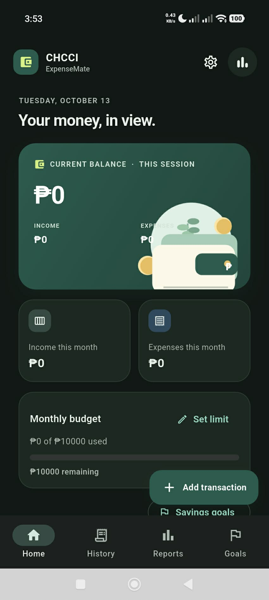
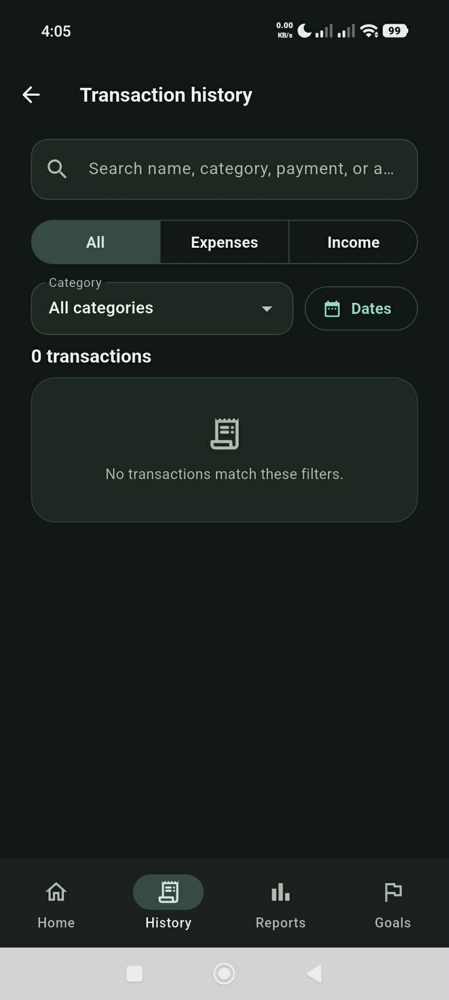
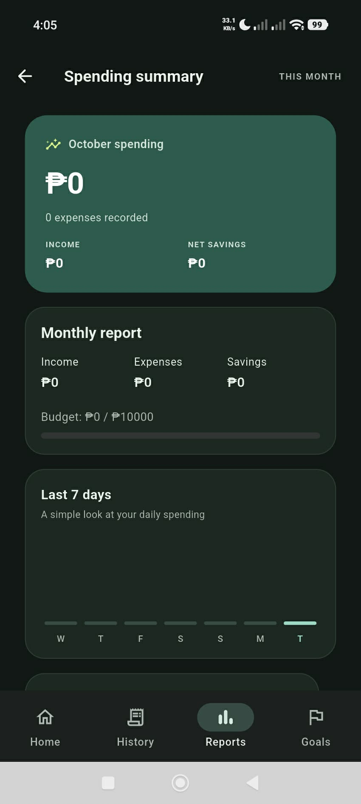
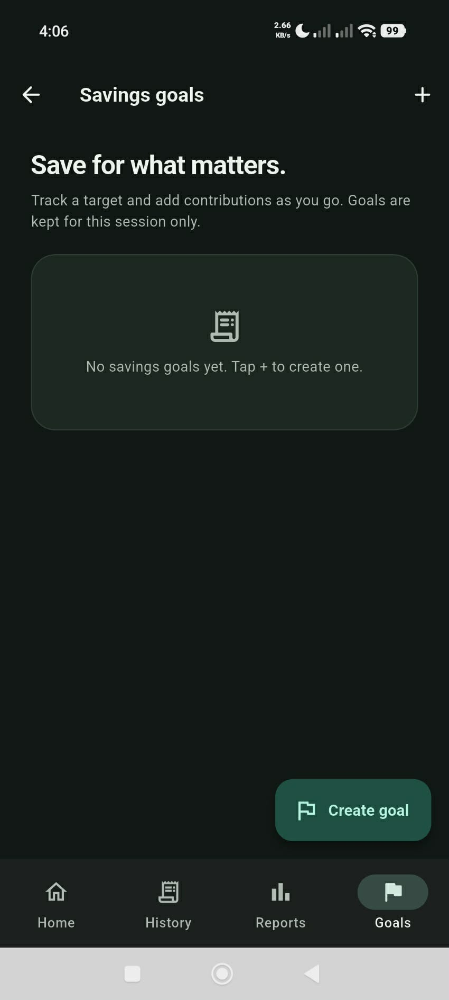
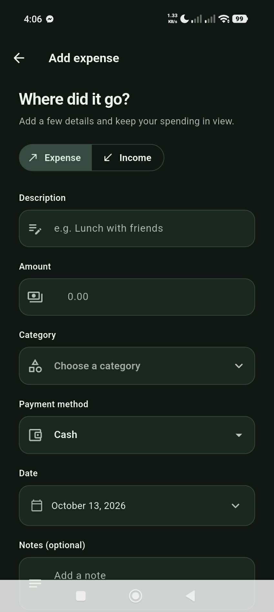
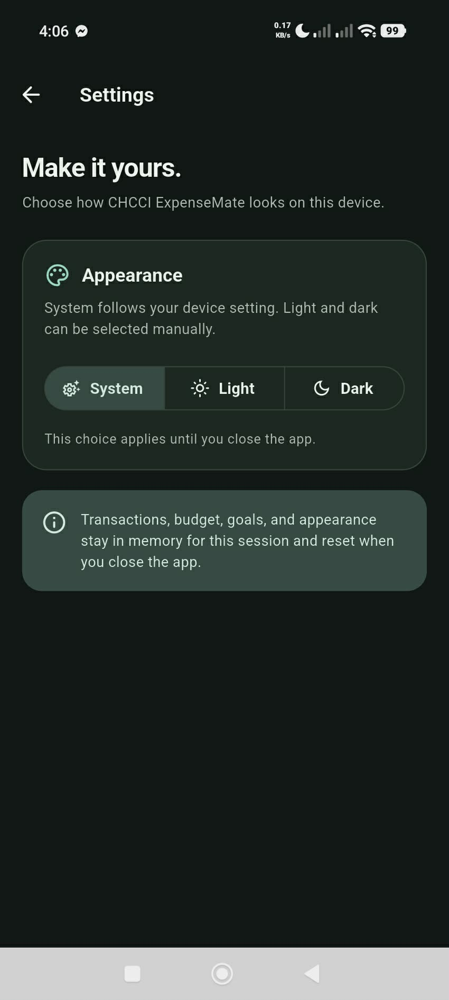
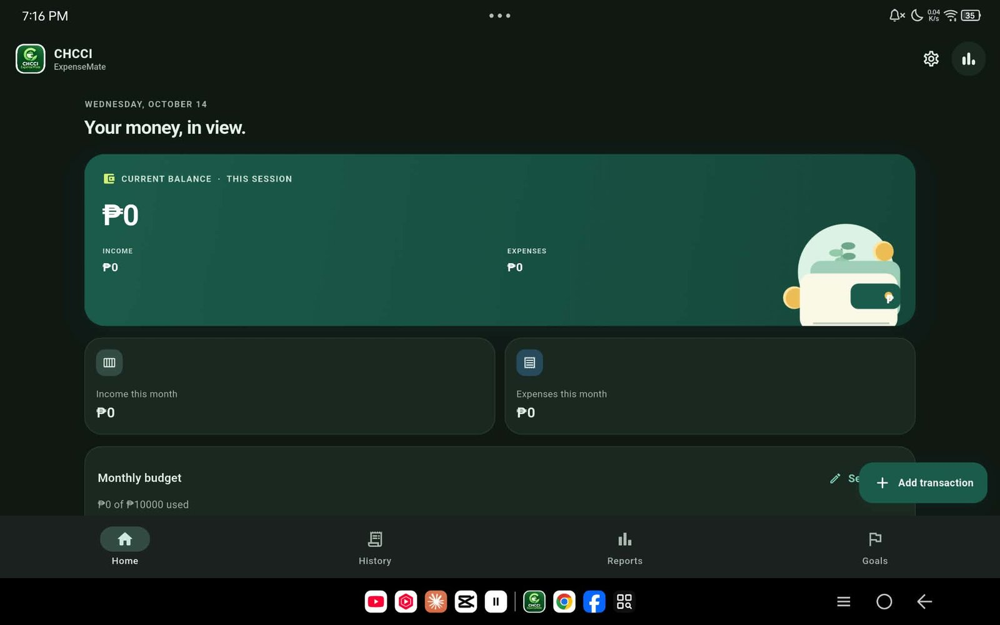
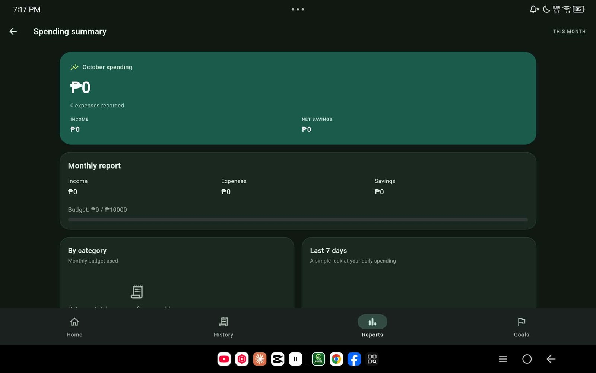
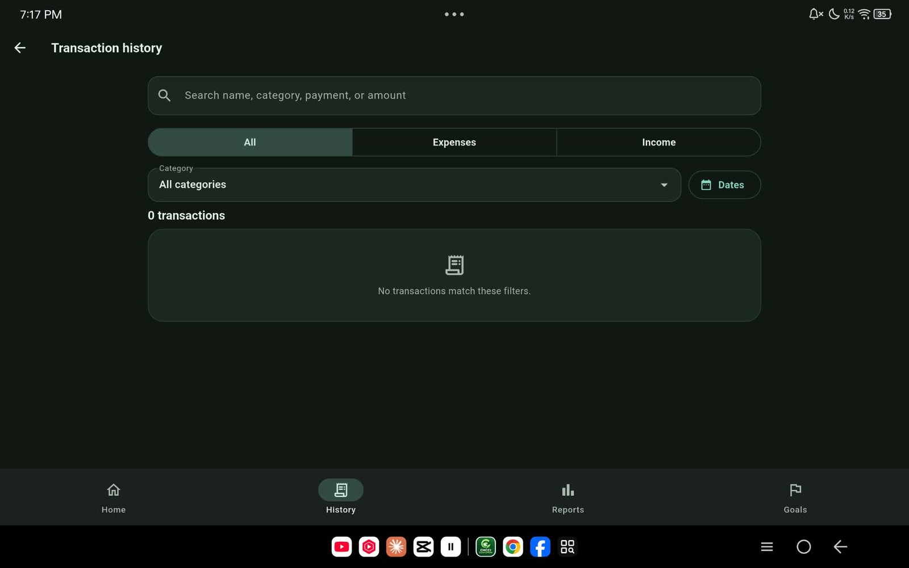
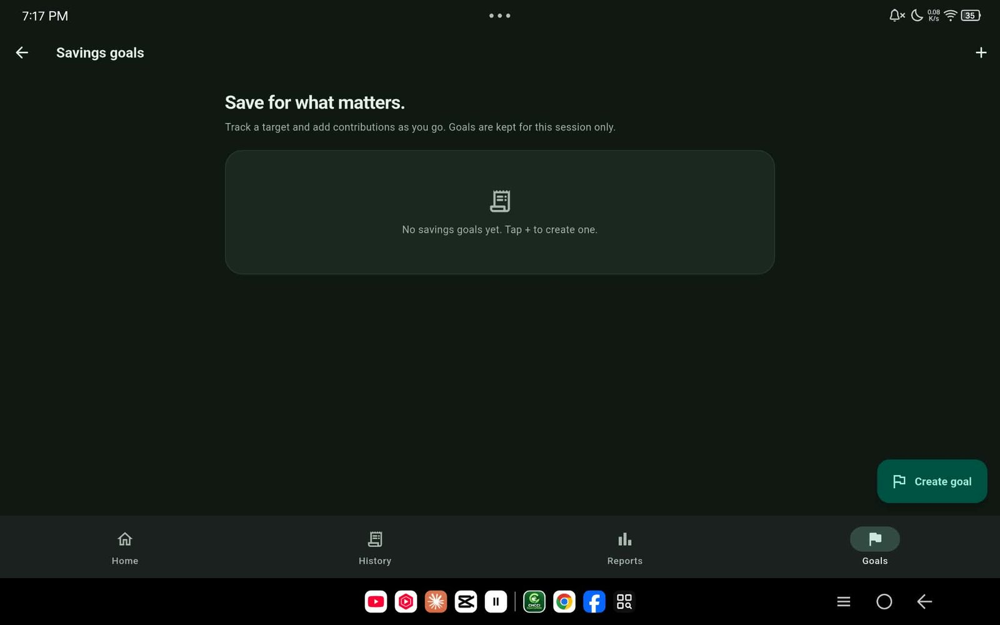

# CHCCI ExpenseMate

## Project description

CHCCI ExpenseMate is a Flutter personal finance tracker for the CSE101 final project. Users can record income and expenses, manage a monthly budget and savings goals, and review searchable transaction history and spending reports.

All transactions, goals, budget, and appearance settings are held in Dart runtime memory only. They reset when the app closes, as required for this project. The app uses no database, file storage, browser storage, or server.

## Features

- Record income and expenses with amount, category, date, payment method, and optional notes.
- Review current balance, income, expenses, and monthly budget progress on the dashboard.
- Search and filter transaction history by type, category, date, and text.
- Edit or delete transactions.
- View monthly income, spending, savings, highest and lowest categories, a pie chart, and a seven-day spending chart.
- Create savings goals and record contributions.
- Mark regular expenses as recurring and manually add a monthly occurrence.
- Navigate between the dashboard, transaction form, history, summary, savings goals, and settings.
- Responsive phone and wide-screen layouts; System, Light, and Dark appearance options.
- Transactions, monthly budget, savings goals, and appearance are temporary runtime data and reset when the app closes. No database or device storage is used.
- Philippine peso amounts and locally bundled artwork.

## Screenshots

The screenshots below are from the submitted project documentation. Select an image to view it at full size.

### Phone screens

| Home | Transaction history |
| --- | --- |
|  |  |

| Spending summary | Savings goals |
| --- | --- |
|  |  |

| Add expense and income | Settings |
| --- | --- |
|  |  |

### Tablet layout (responsive)

| Home | Spending summary |
| --- | --- |
|  |  |

| Transaction history | Savings goals |
| --- | --- |
|  |  |

## Run and build

```powershell
flutter pub get
flutter run
flutter test
flutter build apk --release
```

To preview the responsive layout in Flutter Web:

```powershell
flutter run -d edge --web-port 54168
```

The Android APK is generated at `build/app/outputs/flutter-apk/app-release.apk` when an Android SDK is installed and configured.

## Download the Android APK

**[Download the latest Android APK](https://github.com/Jynxnanana/Personal_Expenses_Tracker/releases/latest/download/CHCCI-ExpenseMate-Android.apk)**. Each successful Android build also creates a GitHub Release with the APK and its SHA-256 checksum. Open the [Releases page](https://github.com/Jynxnanana/Personal_Expenses_Tracker/releases) to view older builds.

## Demo flow

Open Home, add an expense, and confirm that the totals update. Use the three-dot menu on an expense to edit or delete it. Open the chart icon to review the Summary.
